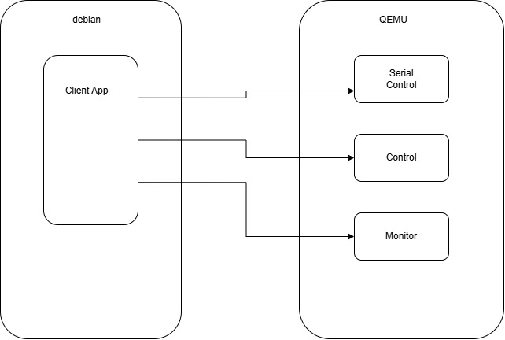

# פרוייקט סיום (שלב א)

אפליקציית הלקוח רצה על מכונת ה-Debian ומדברת עם שרת שרץ בתוך מכונת QEMU, בשלושה ערוצים:

| ערוץ | תווך | כתובת בצד הלקוח | בצד השרת (בתוך QEMU) | פקודות |
|---|---|---|---|---|
| Control | TCP, פרוטוקול בינארי | `127.0.0.1:5000` | מאזין על פורט 5000 | Alive, Get Sensor Value, Set Sensor Limits |
| Serial Control | פורט טורי של QEMU חשוף כ-TCP, אותו פרוטוקול בינארי | `127.0.0.1:5002` | קורא וכותב ל-`/dev/ttyS1` | אותן פקודות כמו Control |
| Monitor | HTTP, שרת Flask, בקשות GET בלבד | `http://127.0.0.1:5001` | Flask על פורט 5001 | Alive, Temperature, RTC, Alerts, Free Memory, CPU Usage, Free Storage |

- ערוצי Control ו-Serial Control משתמשים בפרוטוקול בינארי עם סימון התחלה ו-CRC בסוף, והם היחידים שמשנים מצב בשרת.
- ערוץ Monitor הוא לקריאה בלבד. הוא מחזיר JSON, ושום בקשה בו לא משנה מצב בשרת.
- ערוץ Serial Control הוא ערוץ גיבוי: הוא עובד גם כשהרשת של המכונה הווירטואלית למטה.

## הגדרת הפרוטוקול הבינארי (Control ו-Serial Control)

| שדה     | גודל | תיאור                                                                        |
| ------- | ---- | ---------------------------------------------------------------------------- |
| SOF     | 2    | סימון התחלה, תמיד `0xAA 0x55`                                                |
| CMD     | 1    | קוד הפקודה. בתשובה: `CMD \| 0x80`                                            |
| LEN     | 2    | אורך ה-PAYLOAD, big-endian                                                   |
| PAYLOAD | LEN  | נתונים. בתשובה הבית הראשון הוא STATUS                                        |
| CRC     | 2    | CRC16-CCITT-FALSE (פולינום `0x1021`, ערך התחלתי `0xFFFF`) על CMD+LEN+PAYLOAD |

כל המספרים ב-big-endian.

| CMD  | פקודה             | PAYLOAD בבקשה                                | נתונים בתשובה (אחרי STATUS) |
| ---- | ----------------- | -------------------------------------------- | --------------------------- |
| 0x01 | Alive             | ריק                                          | ריק                         |
| 0x02 | Get Sensor Value  | sensor `uint8`                               | sensor `uint8`, ערך `int16` |
| 0x03 | Set Sensor Limits | sensor `uint8`, lower `int16`, upper `int16` | ריק                         |

**קודי STATUS:** 0=OK, 1=פקודה לא מוכרת, 2=CRC שגוי, 3=PAYLOAD שגוי, 4=חיישן לא קיים, 5=שגיאה פנימית.

## הגדרת ה-API של Monitor (HTTP GET בלבד)

כל התשובות ב-JSON. כל מתודה שאינה GET מחזירה `405 Method Not Allowed`.

| בקשה                     | תשובה לדוגמה                                                                             |
| ------------------------ | ---------------------------------------------------------------------------------------- |
| `GET /alive`             | `{"status": "alive"}`                                                                    |
| `POST /temperature`      | `{"celsius": 42.0}`                                                                      |
| `POST /rtc`              | `{"unix": 1794850000, "iso": "2026-11-16T18:46:40"}`                                     |
| `POST /memory`           | `{"free_kb": 812345}`                                                                    |
| `POST /cpu`              | `{"usage_percent": 3.2}`                                                                 |
| `GET /storage`           | `{"free_bytes": 5368709120}`                                                             |
| `GET /alerts?since=<id>` | `{"alerts": [{"id": 7, "sensor": 0, "kind": "HIGH", "value": 265, "time": 1794850012}]}` |

---

## משימות 
1. בניית התשתית 
	1. אפליקציית Serial מינימלית
	2. אפליקציית TCP Server מינימלית
	3. אפליקציית Rest API מינימלית
	4. אפליקציית Client - לולאה פשוטה פעם ב X שניות מפעילה פונקציה אחת בשרת
2. כתיבת סקריפטים (BASH)
	1. הפעלת QEMU כולל UART
	2. הפעלת שלושת האפליקציות על המכונה הוירטואלית
3. מימוש תשתית פרוטוקול 
	1. בניית הודעה
	2. פירוק הודעה
4. שילוב מנגנון הודעות ומימוש כלל ההודעות
5. בניית טסטים - הרצה עם פרמטר מיוחד מבצעת SELF TEST על כל הקריאות האפשריות
6. ניתור באמצעות WireShark - הקלטה
7. כתיבת סקריפט לניתוח PCAP